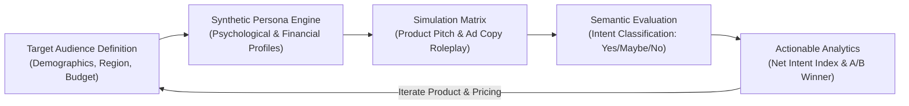

# Synthetic Shopper Simulator — Project Idea & Vision

> **An AI-powered virtual consumer simulator designed to evaluate product ideas, marketing concepts, and feature tradeoffs against authentic synthetic customer archetypes in seconds.**

---

## 1. Executive Summary

In traditional consumer research, evaluating a new product concept, packaging design, or marketing message takes weeks or months and thousands of dollars in agency fees, focus groups, and survey panels. 

**Synthetic Shopper** bridges this gap by creating an **autonomous, persona-driven consumer simulator**. Powered by high-speed Large Language Models (LLMs) and structured psychological persona modeling, the platform enables product managers, brand strategists, and consumer goods innovators (such as FMCG brands like Colgate, consumer electronics, and lifestyle startups) to:

1. **Synthesize diverse, authentic consumer cohorts** grounded in specific geographic, financial, and behavioral demographics.
2. **Pitch product propositions and marketing ad copies** directly to these synthetic personas.
3. **Capture unfiltered, persona-authentic feedback** including raw quotes, perceived benefits, friction points, and price sensitivity reactions.
4. **Transform qualitative feedback into quantitative business metrics**—including Net Intent Index, purchase likelihood classifications (*Definitely Yes*, *Maybe*, *No*), demographic cross-tabulations, and head-to-head A/B concept comparison matrices.

---

## 2. The Problem Statement

| Traditional Market Research | The Reality & Pain Points |
| :--- | :--- |
| **Slow Cycle Times** | Setting up focus groups, recruiting respondents, and aggregating surveys takes 3 to 8 weeks. |
| **High Costs** | High agency fees ($10,000–$50,000+ per research cycle) prevent iterative testing of early-stage ideas. |
| **Courtesy & Self-Reporting Bias** | Human survey respondents often answer politely or fail to predict their own purchasing behavior realistically. |
| **Stale Insights** | By the time survey results arrive, market conditions, competitor campaigns, or sprint deadlines have moved on. |
| **Binary Feedback** | Standard surveys ask simple Likert-scale questions without offering deep, interactive qualitative context on *why* someone hesitated. |

---

## 3. The Core Idea: The Synthetic Consumer Intelligence Flywheel

The core thesis of Synthetic Shopper is that **advanced LLMs, when constrained by realistic psychological personas and strict socioeconomic parameters, accurately model consumer deliberation, objection patterns, and price elasticity.**



### The 4-Step Flywheel

1. **Cohort Specification**: The user defines an audience segment (e.g., *"Young working professionals in urban India seeking sustainable personal care"* or *"College students looking for budget audio gadgets"*).
2. **Autonomous Persona Generation**: The system synthesizes nuanced personas with unique names, ages, cities, monthly incomes, price sensitivity ratings, personality traits, and lifestyle bios.
3. **In-Character Deliberation**: Each persona is presented with a product proposition (title, category, price, description, marketing ad copy) and evaluates it strictly from their personal economic and psychological standpoint.
4. **Synthesis & Strategic Takeaways**: The system translates individual reactions into a holistic product score, identifying primary purchase drivers, top friction points, and concrete recommendations to convert hesitant shoppers.

---

## 4. Key Platform Capabilities

### 1. Synthetic Persona Factory
- Generates 1 to 20 distinct, culturally grounded synthetic consumer profiles per batch.
- Models critical economic parameters: local currency income, price sensitivity levels (`low`, `medium`, `high`), and lifestyle preferences.
- Prevents caricature stereotyping by enforcing realistic socioeconomic constraints and diverse life circumstances.

### 2. Multi-Persona Simulation Engine
- Conducts individual, concurrent persona roleplay simulations.
- Captures multi-dimensional qualitative feedback:
  - **Consideration Statement**: Realistic 1–2 sentence assessment of purchase viability.
  - **Attractions**: Top 2–3 appealing features or messaging hooks.
  - **Friction & Concerns**: Realistic reservations regarding utility, routine disruption, skepticism, or alternative habits.
  - **Verbatim Voice Quote**: Raw, first-person natural language reaction.
  - **Willingness-to-Pay Feedback**: Direct reaction to the exact price point relative to personal monthly income.

### 3. Quantitative Intent Classification & Scoring
- Classifies each shopper’s reaction into **Definitely Yes**, **Maybe**, or **No** with an individual confidence score (0–100%).
- Computes the **Net Intent Index (0–100)**: A unified benchmark of cohort-level purchase readiness.
- Extracts primary purchase drivers and primary objection categories across the cohort.
- Provides an automated **Executive Summary** with prioritized optimization recommendations.

### 4. Demographic Cross-Tabulation & Segmentation
- Breaks down purchase intent across key demographics:
  - **Price Sensitivity**: High vs. Medium vs. Low sensitivity cohorts.
  - **Age Brackets**: 18–25, 26–35, 36–50, and 50+.
  - **Income Tiers**: Entry, middle, and affluent income brackets.
- Ranks objections and drivers by frequency to identify systemic conversion blockers.

### 5. Head-to-Head A/B Concept Comparison Matrix
- Compares competing product variants, pricing models, or ad copy angles side-by-side.
- Computes Intent Score deltas, price differentials, and automatically identifies the winning concept with strategic reasoning.

### 6. Production Resilience & Telemetry
- Sliding-window rate limiters protecting upstream LLM quotas.
- Real-time token consumption tracking and operational cost estimation (USD).
- Exponential backoff retries with jitter and graceful degradation during network or database anomalies.

---

## 5. Primary Use Cases

### A. FMCG & Personal Care Brands (e.g., Oral Care, Skincare, Hygiene)
- **Scenario**: Testing a new premium electric toothbrush with whitening LED technology priced at ₹2,499 vs. a baseline model at ₹999.
- **Outcome**: Discover that high-income urbanites love the aesthetic but hesitate over replaceable brush head availability, while middle-income personas find the price point prohibitive without a clinical trial endorsement.

### B. Product Managers & Innovation Teams
- **Scenario**: Deciding whether to package a high-end software tool or consumer gadget with an annual subscription or a one-time purchase.
- **Outcome**: Instant read on price elasticity and feature demand across different professional segments.

### C. Marketing & Creative Agencies
- **Scenario**: Stress-testing three alternative ad copy hooks (*"Eco-friendly zero plastic"* vs. *"Dentist-grade clean in 2 minutes"* vs. *"Smart app-connected timer"*).
- **Outcome**: Clear identification of which hook drives the highest "Definitely Yes" conversion among the core demographic.

---

## 6. High-Level Technology Stack

```
Synthetic Shopper Platform
│
├── Frontend (React 19 + TypeScript + Tailwind CSS v4 + Vite)
│   ├── Interactive Persona & Batch Management
│   ├── Product Pitch & Ad Copy Simulation Runner
│   ├── Decision Filter Tabs & Individual Persona Cards
│   ├── Demographic Cross-Tabulation & Frequency Charts
│   └── Side-by-Side A/B Product Concept Matrix
│
├── Backend (Node.js + Express + ES Modules)
│   ├── Groq LLM API Integration (openai/gpt-oss-120b)
│   ├── Strict JSON Schema Validation via Zod
│   ├── Reliability Engine (Sliding Rate Limiter, Retries, Concurrency Controls)
│   └── Analytics & Cross-Tab Aggregation Engine
│
└── Database (MongoDB Atlas + Mongoose ORM)
    ├── Shopper Profiles & Batch Collections
    ├── Simulation Runs & Persona Reaction Records
    └── Telemetry Logs (Tokens, Latency, Estimated Cost)
```

---

## 7. Business Value & Return on Investment (ROI)

| Metric | Traditional Panel Research | Synthetic Shopper Simulator |
| :--- | :--- | :--- |
| **Turnaround Time** | 3 to 6 weeks | **< 30 seconds** |
| **Cost Per Study** | $5,000 – $30,000+ | **Fraction of a cent (< $0.05 in LLM tokens)** |
| **Iteration Capacity** | 1 to 2 cycles per quarter | **Unlimited real-time rapid prototyping** |
| **Objection Discovery** | Generic multiple-choice ratings | **Nuanced verbatim quotes + root cause drivers** |
| **Concept Testing** | Sequential, slow testing | **Instant side-by-side A/B Matrix comparisons** |

---

## 8. Summary

The **Synthetic Shopper Simulator** transforms consumer research from a slow, retrospective hurdle into an agile, real-time superpower. By simulating authentic consumer friction, price sensitivity, and purchase triggers before committing physical capital or ad budget, teams can launch winning products with conviction.
